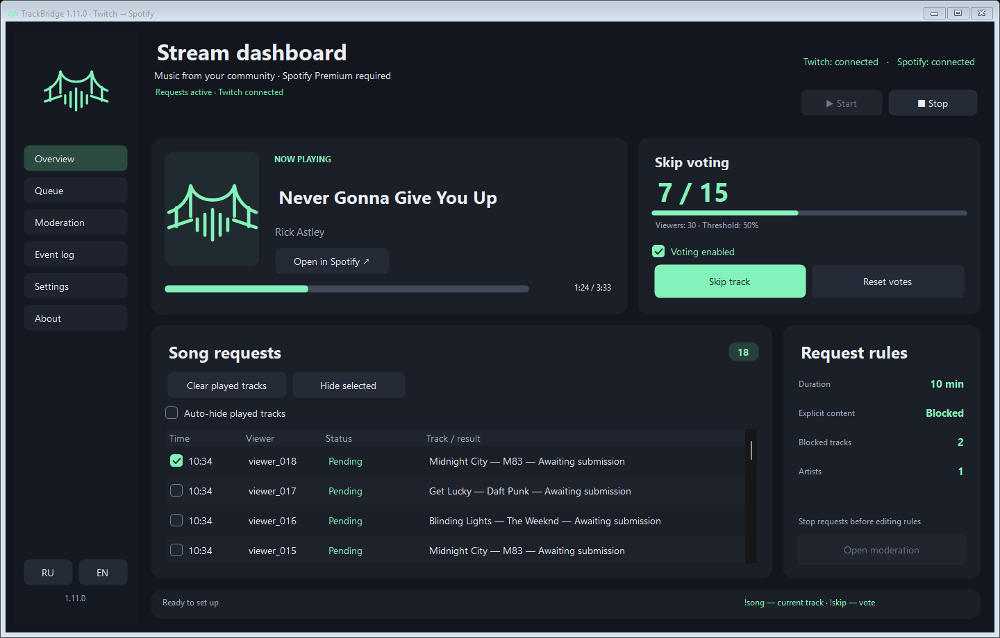

**Spotify Premium required. Adding tracks to the Spotify queue requires Premium.**

# TrackBridge

**Windows · 1.11.0 · by Rub1nchik**

**English** · [Русский](README.ru.md)

Twitch Channel Points song requests → your Spotify queue. Viewers submit a link; TrackBridge adds a matching Spotify track without interrupting the current song.

**[Download](https://github.com/Rub1nchik702/TrackBridge/releases/latest)** · **[Setup with screenshots](https://github.com/Rub1nchik702/TrackBridge/blob/main/docs/GUIDE.md#setup)** · [Report a problem](https://github.com/Rub1nchik702/TrackBridge/issues/new/choose)

## Features

- Spotify links and Spotify matching for YouTube / YouTube Music links.
- Refunds for rejected requests, moderation rules and duplicate prevention.
- `!song` / `!nowplaying` for the current track; `!skip` / `!voteskip` for skip voting.
- Quiet notification sound: adjustable volume, your own audio file, or the built-in chime.
- Request checkboxes, bulk history hiding, played-history cleanup, RU/EN UI and updates.
- Moderation in the sidebar, dark scrollbars and short page transitions that follow Windows animation preferences.

## Get started

1. Download the ZIP, extract all files into a writable folder and run `TrackBridge.exe`.
2. In **Settings**, connect your Spotify and Twitch developer apps and select or create a reward. Follow the [illustrated guide](https://github.com/Rub1nchik702/TrackBridge/blob/main/docs/GUIDE.md#setup) for the exact fields.
3. Start Spotify playback, open **Overview** and click **Start**. Wait for **Requests active**.

Requires Windows 10/11, .NET Framework 4.7.2+, Spotify Premium and a Twitch channel with custom Channel Points rewards. Each broadcaster uses their own developer app Client IDs.

## Sound and history

**Settings → Choose audio…** selects a custom MP3 or another format supported by Windows; up to 50 MB. The first five seconds are converted locally to WAV. **Default sound** restores the built-in chime. The chosen file is copied into `data` and the volume setting applies to it.

Check request rows, then click **Hide selected** to hide them from the list. This does not cancel requests or remove Spotify songs. **Clear played tracks** only clears entries whose playback TrackBridge observed.

## Updates

Keep the `data` folder when updating manually; it contains your settings and account access. Do not share it. Automatic updates verify the publisher signature and SHA-256.

Version 1.10.0 can update to 1.11.0 through the built-in updater.

## Source, rights and support

Source is available in [src](src). Build on Windows with `powershell -NoProfile -File .\build.ps1`, or use GitHub Actions.

[License](LICENSE.txt): personal use and study are allowed; sale and redistribution of modified code or builds need the author's written permission. The TrackBridge name and logo identify official releases. This is source-available, not OSI open source.

TrackBridge controls your Spotify player and grants no music or broadcasting rights. Users must obtain the necessary permissions and follow service terms.

[Full guide](https://github.com/Rub1nchik702/TrackBridge/blob/main/docs/GUIDE.md) · [Changelog](CHANGELOG.md) · [Project repository](https://github.com/Rub1nchik702/TrackBridge)

Author: **Rub1nchik**. Development assistance: **OpenAI Codex**.