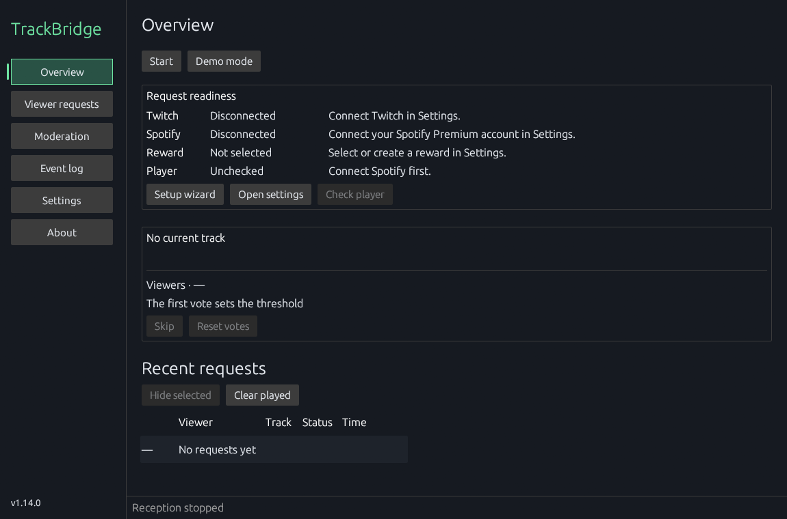
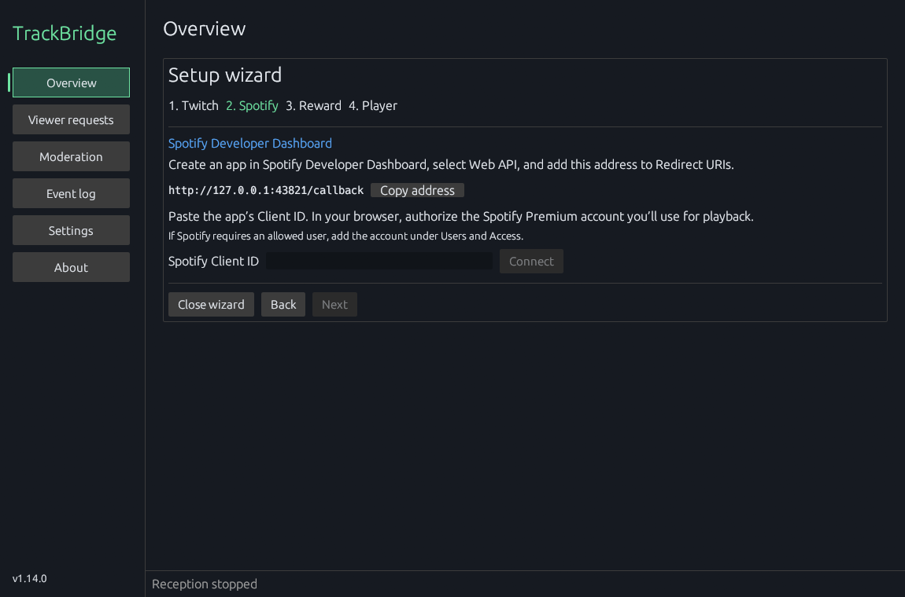

**Spotify Premium required. Adding tracks to the Spotify queue requires Premium.**

# TrackBridge

**Windows · 1.14.0 · by Rub1nchik**

**English** · [Русский](README.ru.md)

Twitch Channel Points song requests → your Spotify queue. Viewers submit a link; TrackBridge adds a matching Spotify track without interrupting the current song.

**[Download TrackBridge.exe](https://github.com/Rub1nchik702/TrackBridge/releases/latest/download/TrackBridge.exe)** · **[Setup with screenshots](https://github.com/Rub1nchik702/TrackBridge/blob/main/docs/GUIDE.md#setup)** · [Report a problem](https://github.com/Rub1nchik702/TrackBridge/issues/new/choose)

## What's new in 1.14.0

- **Setup wizard** walks through Twitch, Spotify, the Channel Points reward and the final player check.
- **Request readiness** on Overview shows which connection or setting needs attention and what to do next.
- **Request review** shows the original link, the reason and any refund countdown. Choose a Spotify track or refund the points from the card.
- **History search** matches viewer names and track titles as you type. Combine it with a status filter.
- **Offline demo** lets you practice a successful request, a refund and manual track selection with disposable test orders.

See the [latest screenshots](docs/GUIDE.md#screenshots) for history, request review, the demo and Settings.

## Features

- Spotify links and Spotify matching for YouTube / YouTube Music links.
- Refunds for rejected requests, moderation rules and duplicate prevention.
- `!song` / `!nowplaying` for the current track; `!skip` / `!voteskip` for skip voting.
- Quiet notification sound: adjustable volume, your own audio file, or the built-in chime.
- Request checkboxes, bulk history hiding, played-history cleanup, RU/EN UI and updates.
- Moderation in the sidebar, dark scrollbars and short page transitions that follow Windows animation preferences.

## Get started

1. Download `TrackBridge.exe`, save it to a writable folder, and run it.
2. On **Overview**, open **Setup wizard** from the readiness card. Connect Twitch and Spotify, select or create a reward, and check your Spotify player. See the [setup guide](docs/GUIDE.md#setup) for the developer app fields.
3. Return to **Overview** and choose **Start**. Wait for **Receiving requests**.

Requires Windows 10/11, Spotify Premium and a Twitch channel with custom Channel Points rewards. Each broadcaster uses their own developer app Client IDs.

## Sound and history

**Settings → Choose audio…** selects a custom MP3 or another format supported by Windows; up to 50 MB. The first five seconds are converted locally to WAV. **Default sound** restores the built-in chime. The chosen file is copied into `data` and the volume setting applies to it.

Check request rows, then click **Hide selected** to hide them from the list. This does not cancel requests or remove Spotify songs. **Clear played tracks** only clears entries whose playback TrackBridge observed.

## Updates

Keep the `data` folder when updating manually; it contains your settings and account access. Do not share it. Automatic updates verify the publisher signature and SHA-256.

## Source, rights and support

The current [Rust source](rust) builds on Windows with stable Rust and the Windows SDK. Run `cargo build --release --locked --manifest-path rust/Cargo.toml`. The previous C# implementation is in [src](src).

[License](LICENSE.txt): personal use and study are allowed; sale and redistribution of modified code or builds need the author's written permission. The TrackBridge name and logo identify official releases. This is source-available, not OSI open source.

TrackBridge controls your Spotify player and grants no music or broadcasting rights. Users must obtain the necessary permissions and follow service terms.

[Full guide](https://github.com/Rub1nchik702/TrackBridge/blob/main/docs/GUIDE.md) · [Changelog](CHANGELOG.md) · [Project repository](https://github.com/Rub1nchik702/TrackBridge)

Author: **Rub1nchik**. Development assistance: **OpenAI Codex**.
