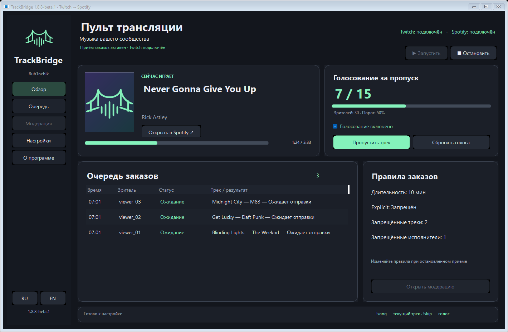
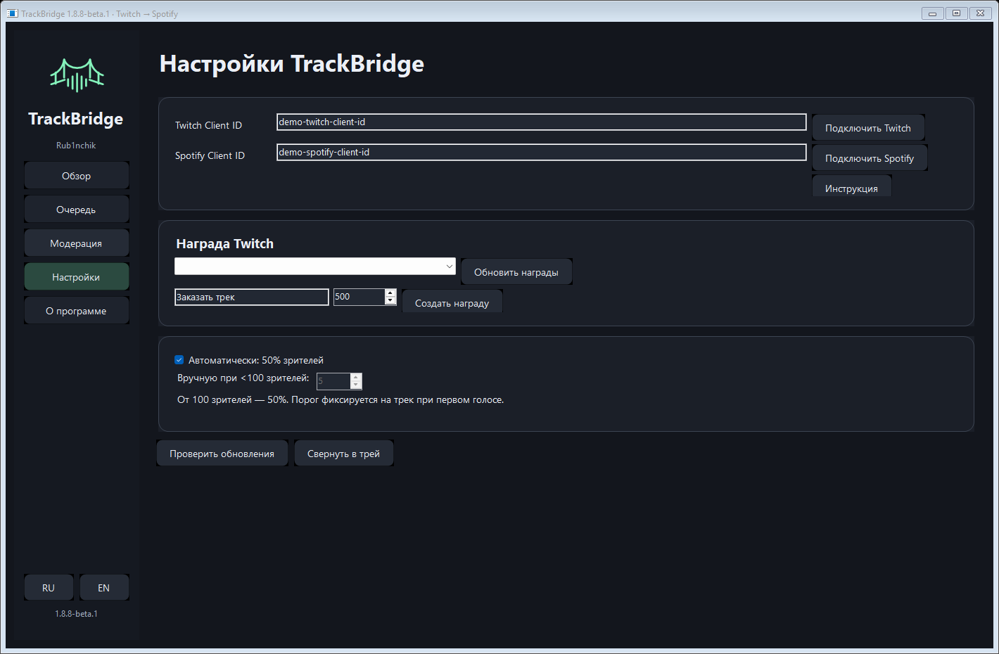
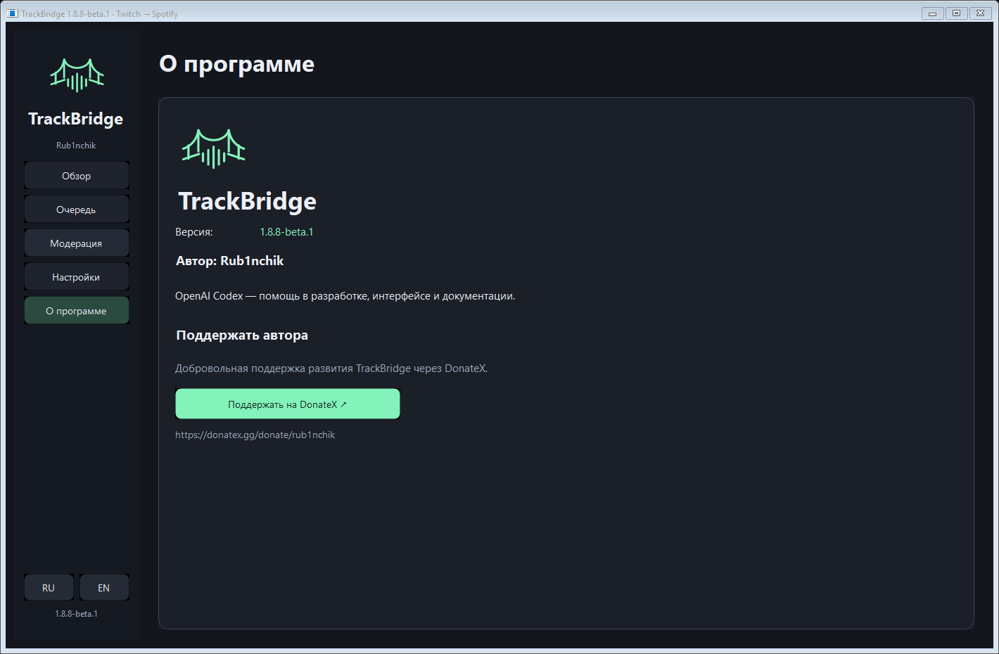

# TrackBridge

**Русский** · [English](README.en.md)

**Автор: Rub1nchik · Windows · Версия 1.8.8-beta.1**

TrackBridge связывает пользовательскую награду за баллы Twitch с очередью вашего Spotify. Зритель отправляет ссылку на песню, программа ищет соответствующий трек в Spotify и добавляет его в конец очереди. Текущая песня не прерывается.

## Права на музыку и использование в эфире

TrackBridge только управляет очередью и воспроизведением в вашем плеере Spotify; программа не передаёт аудиопоток зрителям. Она не предоставляет прав на музыку или её использование в эфире, трансляциях и записях. Пользователь самостоятельно обеспечивает необходимые права и разрешения и соблюдает права правообладателей, применимое законодательство и условия Spotify, Twitch и других используемых сервисов. Spotify Premium, наличие трека в каталоге и успешное добавление в очередь не означают разрешения на вещание.

## Скриншоты

Интерфейс **TrackBridge 1.8.8-beta.1**. Снимки из опубликованной версии приложения с демонстрационными данными; реальные аккаунты и токены не показаны.

### Обзор — текущий трек, голосование и очередь

### Настройки — подключения и параметры

### О программе — версия, автор, OpenAI Codex и DonateX

## Команды чата

- `!song` или `!nowplaying` — название и ссылка на текущий трек Spotify; общий интервал ответов — 5 секунд.
- `!skip` или `!voteskip` — голос за пропуск. В автоматическом режиме нужно 50% текущих зрителей с округлением вверх (11 зрителей → 6 голосов). При аудитории меньше 100 зрителей владелец может отключить автоматический режим и задать от 1 до 99 голосов; от 100 зрителей всегда применяется 50%.
- Число зрителей запрашивается у Twitch при первом голосе, порог фиксируется до смены трека. Если эфир не идёт или счётчик недоступен, новые голоса не принимаются. Повторные голоса одного Twitch user ID не учитываются. После смены трека или возврата к началу песни голоса сбрасываются. Настройки меняются при остановленном приёме.
- Команды работают после нажатия «Запустить» при активном плеере Spotify. Один раз переподключите Twitch и разрешите чтение и отправку сообщений чата. Пропуск не возвращает баллы за заказ.

## Возможности

- Прямые ссылки Spotify.
- Поиск в Spotify по ссылкам YouTube и YouTube Music: текст в круглых и квадратных скобках заголовка игнорируется.
- Автоматическая проверка и загрузка новых сборок из GitHub Releases с проверкой SHA-256.
- Русский и английский интерфейс с кнопками RU/EN в боковом меню. Язык применяется сразу и сохраняется, введённые Client ID и собственное название награды не меняются. Старые строки журнала остаются на исходном языке; новые уведомления в чате используют выбранный язык.
- Возврат баллов и уведомление в чате Twitch, если совпадение не найдено.
- Получение событий Twitch и резервная проверка незавершённых покупок каждые 10 секунд.
- Защита от повторного добавления заказа, обработка неоднозначного ответа вручную.
- Работа в системном трее, хранение токенов с шифрованием Windows DPAPI.

## Скачать и запустить

Скачайте архив `TrackBridge-1.8.8-beta.1-win.zip` из раздела **Releases** этого репозитория. Распакуйте его полностью в отдельную папку, доступную для записи, и запустите `TrackBridge.exe`.

Требования: Windows 10/11, .NET Framework 4.7.2 или новее, Spotify Premium и активный плеер Spotify. На Twitch-канале должны быть доступны пользовательские награды за баллы.

Приложение пока не подписано сертификатом Windows. Сборка из опубликованных исходников выполняется без обфускации.

## Первое подключение

1. В [Spotify Developer Dashboard](https://developer.spotify.com/dashboard) создайте собственное приложение с Web API. Redirect URI должен быть точно `http://127.0.0.1:43821/callback`.
2. Скопируйте Spotify **Client ID** в TrackBridge и нажмите «Подключить Spotify». Client Secret не нужен. При необходимости добавьте свой Spotify-аккаунт в список разрешённых пользователей приложения.
3. В [Twitch Developer Console](https://dev.twitch.tv/console/apps) создайте приложение типа **Public**. Если кабинет требует Redirect URL, укажите `http://localhost:43821`; используемый Device Code Flow не использует это перенаправление.
4. Введите Twitch **Client ID**, нажмите «Подключить Twitch» и подтвердите подключение аккаунтом владельца канала. Разрешение на сообщения в чате нужно для уведомлений о возврате баллов.
5. Создайте награду через TrackBridge или выберите награду, ранее созданную тем же Twitch Client ID. Награда должна требовать ввод текста и сохранять покупки в очереди запросов.
6. Откройте Spotify, выберите устройство и включите музыку. В TrackBridge выберите награду и нажмите **«Запустить»**.
7. Дождитесь сообщения **«Приём заказов активен»**, затем отправьте тестовый заказ через выбранную награду.

Подключение аккаунтов само по себе не запускает обработку заказов. Каждый пользователь регистрирует свои приложения: общий Client ID для массового использования не предоставляется.

## Ограничения beta-версии

- Заказы добавляются в конец существующей ручной очереди Spotify. Подтверждение награды означает добавление трека, а не его полное проигрывание.
- Поиск по названию может не найти песню, которая фактически есть в каталоге. Прямая ссылка Spotify надёжнее.
- Если ответ Spotify потерян, заказ получает статус «Проверьте вручную». Проверьте очередь Spotify и выберите подтверждение или возврат через контекстное меню заказа.
- После запуска обрабатываются также незавершённые покупки выбранной награды, сделанные во время простоя. Ненужные покупки заранее отклоните в Twitch.

OBS-карточка и кликабельное Twitch-расширение не входят в этот выпуск.

## Данные и безопасность

Токены, Client ID и история заказов находятся в `data/settings.bin` рядом с программой и защищены DPAPI для текущего пользователя Windows. Не публикуйте и не передавайте папку `data`. Шифрование не защищает от программ, работающих с правами того же пользователя Windows.

Обновления проверяются автоматически при запуске и каждые шесть часов в публичном репозитории Rub1nchik702/TrackBridge (учитываются и beta-релизы). Новая сборка автоматически загружается в `.updates` рядом с программой и проверяется по SHA-256, опубликованному GitHub. Когда она готова, нажмите «Установить обновление»: приложение запросит перезапуск, остановит приём и заменит только файлы дистрибутива. Папка `data` сохраняется; при ошибке замены уже изменённые файлы откатываются. Нужен доступ на запись в папку приложения. Если GitHub недоступен, заказы продолжают обрабатываться. Проверить обновление вручную можно кнопкой «Проверить обновления». Версию 1.8 нужно установить вручную один раз: в 1.7 обновляющего механизма ещё нет. Для ручного обновления закройте TrackBridge и замените `TrackBridge.exe`, сохранив папку `data`. Для сброса настроек закройте программу и переименуйте `data`. Доступ к аккаунтам можно отозвать в настройках подключённых приложений Twitch и Spotify.

Сообщая об ошибке, приложите версию, шаги воспроизведения и очищенные строки журнала. Не отправляйте токены, файлы настроек, коды авторизации или Client Secret.

## Лицензия и распространение

Исходники TrackBridge доступны в [src](src) для изучения и личных изменений на условиях [LICENSE.txt](LICENSE.txt). Продажа и распространение изменённых сборок или исходников без письменного разрешения Rub1nchik запрещены. Название и логотип сохраняются за официальными выпусками. Это source-available, а не OSI open source.

Приложение управляет вашим Spotify и не предоставляет прав на передачу музыки в эфир. Premium не заменяет права на вещание. Пользователь должен соблюдать правила [Spotify](https://developer.spotify.com/policy) и Twitch. TrackBridge не является официальным продуктом Spotify, Twitch, YouTube.

Приложение доступно бесплатно. Добровольно поддержать автора можно через DonateX в разделе «О программе»; пожертвование не требуется для использования.

## Защита очереди и обновлений с 1.8.2

Одновременно в приложении хранится до 100 активных заказов и 500 завершённых записей, журнал идентификаторов дедупликации ограничен 5000 записями. До трёх активных заказов на зрителя; лишние принятые запросы отклоняются с возвратом баллов. При заполнении общей очереди новые покупки остаются в очереди Twitch до освобождения места — это не автоматический возврат. Заказ с временной ошибкой откладывается, а после трёх неудачных попыток направляется на возврат; если Twitch не может завершить обработку, потребуется ручное решение.

Начиная с 1.8.2, будущие обновления требуют независимую подпись издателя RSA/SHA-256 с закреплённым публичным ключом. Для доверенного перехода с 1.8/1.8.1 установите 1.8.2 вручную из доверенного дистрибутива: старые версии ещё не умеют проверять подпись. Это отдельная подпись пакета обновления, не сертификат Authenticode для Windows.

## Управление и модерация

Панель показывает текущий трек, число зрителей Twitch и прогресс голосования. Нажатие на трек открывает Spotify. Число зрителей обновляется примерно каждые 30 секунд; порог голосования сохраняется до конца трека.

Кнопки «Пропустить трек» и «Сбросить голоса» доступны при запущенном приёме. Переключатель отключает голосование зрителей, сохраняя команды текущего трека. Сброс голосов не снимает защиту от повторного запроса пропуска при неоднозначном ответе Spotify.

В «Модерация заказов» при остановленном приёме задаются лимит длительности (по умолчанию 10 минут, 0 — без лимита), запрет Explicit и списки запрещённых треков/исполнителей. По одной записи на строку; точное совпадение без учёта регистра. Для трека используйте ссылку Spotify или точное название; запрет по названию распространяется на всех исполнителей. Для исполнителя укажите точное имя Spotify. Explicit определяется только отметкой Spotify и не гарантирует фильтрацию всех нежелательных текстов.

Правила применяются к новым и ожидающим отправки заказам, включая прямые ссылки Spotify. Уже добавленные в Spotify треки не удаляются. За отклонённые заказы возвращаются баллы; недоступные данные Spotify обрабатываются как временная ошибка.

## Интерфейс

В боковом меню: «Обзор», «Очередь», «Модерация» и «Настройки». Подключение аккаунтов, награда Twitch, порог голосования и обновления находятся в «Настройки». Запуск и остановка приёма — в «Обзор».

Карточка плеера показывает название, исполнителя, доступную обложку Spotify и прогресс воспроизведения. Карточка голосования отображает голоса и фиксированный порог. Новый логотип моста со звуковой волной используется также в иконке программы и трея.

## Сборка из исходников

На Windows запустите `powershell -NoProfile -File .\build.ps1`. Требуется .NET Framework 4.7.2 или новее с компилятором C#. Результат находится в `dist`. GitHub Actions выполняет ту же сборку при изменениях main и по ручному запуску, без обфускации. Артефакт привязан к коммиту; побайтовая воспроизводимость не заявляется.

Workflow не получает секретов и не подписывает автообновления. Артефакты Actions предназначены для ручной установки; официальный пакет автообновления дополнительно подписывается автором вне CI. В src/SigningKey.cs находится только публичный ключ проверки, не секрет. Не публикуйте data, .updates, токены, приватные ключи и локальную историю. Изучение кода не является гарантией безопасности любой сторонней сборки.

## Участники

- **Rub1nchik** — автор и владелец TrackBridge.
- **OpenAI Codex** — помощь в разработке, оформлении интерфейса и документации.

## О программе

В боковом меню «О программе» указаны текущая версия, автор Rub1nchik и помощь OpenAI Codex. Кнопка DonateX открывает страницу добровольной поддержки: https://donatex.gg/donate/rub1nchik.
