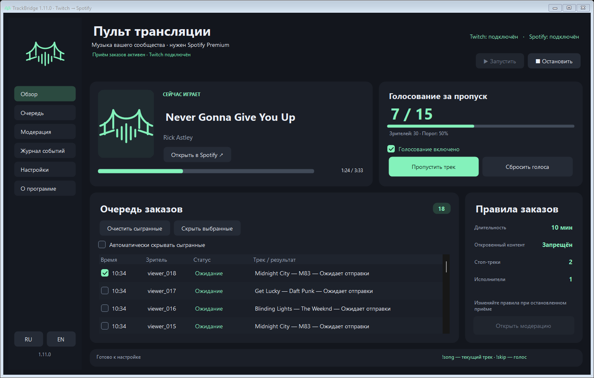

**Нужен Spotify Premium. Без Premium добавление треков в очередь Spotify недоступно.**

# TrackBridge

**Windows · 1.11.0 · автор Rub1nchik**

[English](README.md) · **Русский**

Заказы музыки за баллы Twitch → ваша очередь Spotify. Зритель отправляет ссылку, приложение добавляет найденный трек, не прерывая текущую песню.

**[Скачать](https://github.com/Rub1nchik702/TrackBridge/releases/latest)** · **[Настройка со скриншотами](https://github.com/Rub1nchik702/TrackBridge/blob/main/docs/GUIDE.ru.md#настройка-по-шагам)** · [Сообщить об ошибке](https://github.com/Rub1nchik702/TrackBridge/issues/new/choose)

## Возможности

- Ссылки Spotify и поиск треков в Spotify по YouTube / YouTube Music.
- Возврат баллов за отклонённые заказы, модерация и защита от дубликатов.
- `!song` / `!nowplaying` — текущий трек; `!skip` / `!voteskip` — голосование за пропуск.
- Негромкий сигнал: регулировка громкости, свой аудиофайл или встроенный звук.
- Выбор заказов флажками, групповое скрытие истории, очистка сыгранных, RU/EN и обновления.
- Модерация в боковом меню, тёмная прокрутка и короткие переходы с учётом настройки анимации Windows.

## Быстрый запуск

1. Скачайте ZIP, распакуйте все файлы в папку, доступную для записи, и запустите `TrackBridge.exe`.
2. В **Настройках** подключите приложения разработчика Spotify и Twitch, создайте или выберите награду. Поля показаны в [пошаговой инструкции](https://github.com/Rub1nchik702/TrackBridge/blob/main/docs/GUIDE.ru.md#настройка-по-шагам).
3. Включите музыку в Spotify, откройте **Обзор** и нажмите **Запустить**. Дождитесь статуса **Приём заказов активен**.

Требуются Windows 10/11, .NET Framework 4.7.2+, Spotify Premium и пользовательские награды за баллы на Twitch. Каждый стример указывает Client ID собственных приложений разработчика.

## Звук и история

**Настройки → Выбрать аудио…** — свой MP3 или другой поддерживаемый Windows аудиофайл до 50 МБ; первые пять секунд сохраняются в WAV. **Стандартный сигнал** возвращает встроенный звук. Программа сохраняет копию файла в `data`; регулятор громкости действует и на свой сигнал.

Отметьте строки флажками и нажмите **Скрыть выбранные**. Это скрывает записи из списка, не отменяя заказ и не удаляя песню из Spotify. **Очистить сыгранные** работает только с записями, воспроизведение которых наблюдало приложение.

## Обновления

При ручном обновлении сохраните папку `data`: в ней находятся настройки и доступ к аккаунтам. Не передавайте её другим. Автообновления проверяют подпись издателя и SHA-256.

С версии 1.10.0 можно перейти на 1.11.0 через встроенное автообновление.

## Исходники, права и поддержка

Исходники находятся в [src](src). Сборка на Windows: `powershell -NoProfile -File .\build.ps1`; также доступна GitHub Actions.

[Лицензия](LICENSE.txt) разрешает изучение и личное использование; продажа и распространение изменённых исходников или сборок требуют письменного разрешения автора. Название и логотип обозначают официальные выпуски. Это source-available, а не OSI open source.

Программа управляет вашим Spotify и не предоставляет прав на музыку или её использование в эфире. Необходимые разрешения и соблюдение условий сервисов обеспечивает пользователь.

[Полная инструкция](https://github.com/Rub1nchik702/TrackBridge/blob/main/docs/GUIDE.ru.md) · [Изменения](CHANGELOG.md) · [Репозиторий проекта](https://github.com/Rub1nchik702/TrackBridge)

Автор: **Rub1nchik**. Помощь в разработке: **OpenAI Codex**.