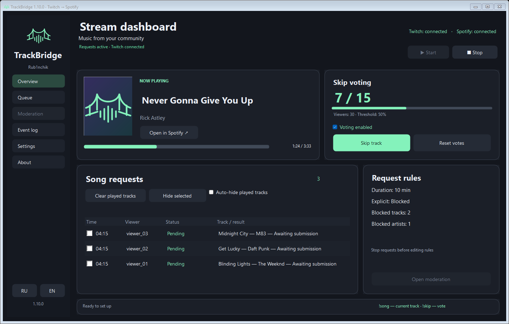
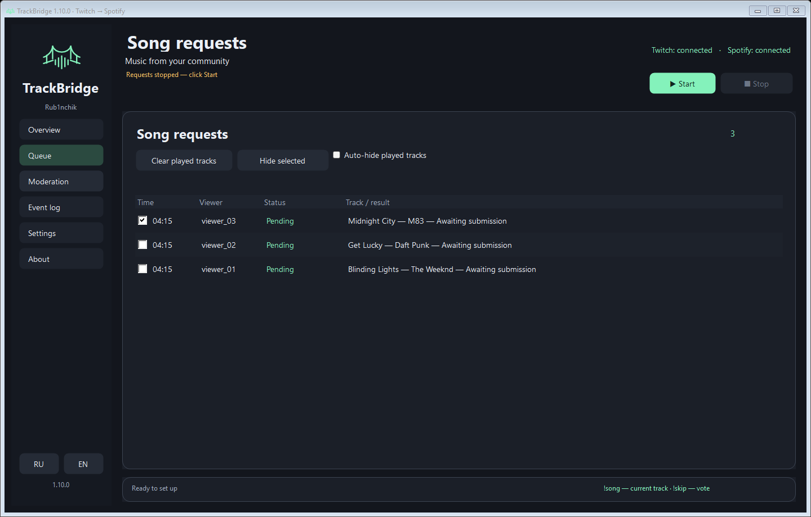
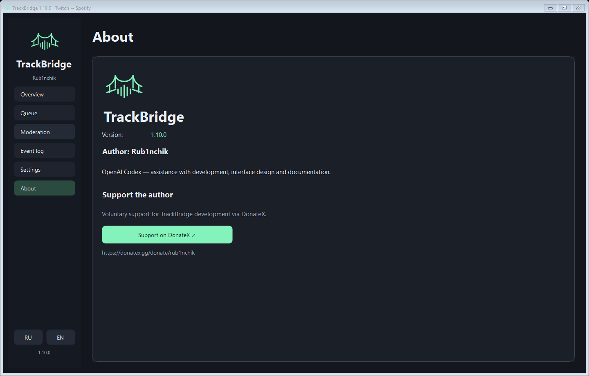
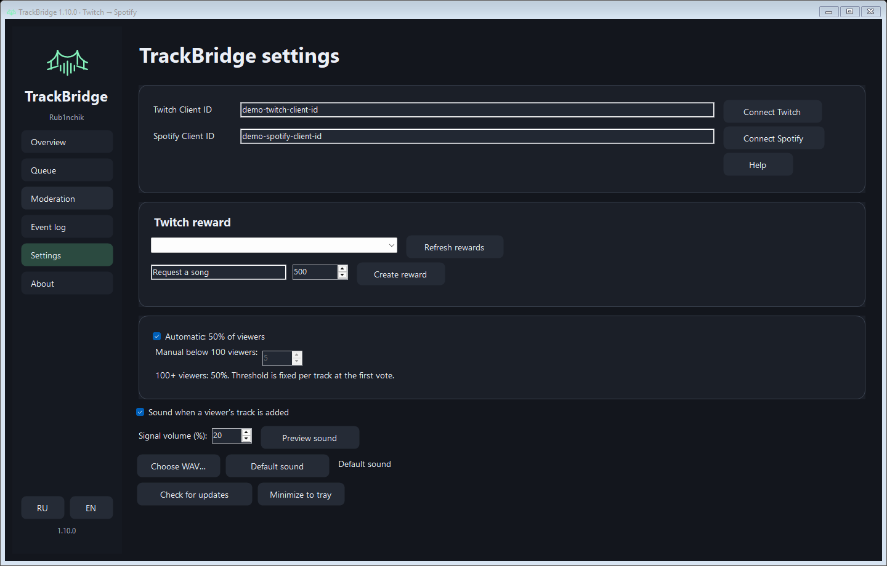
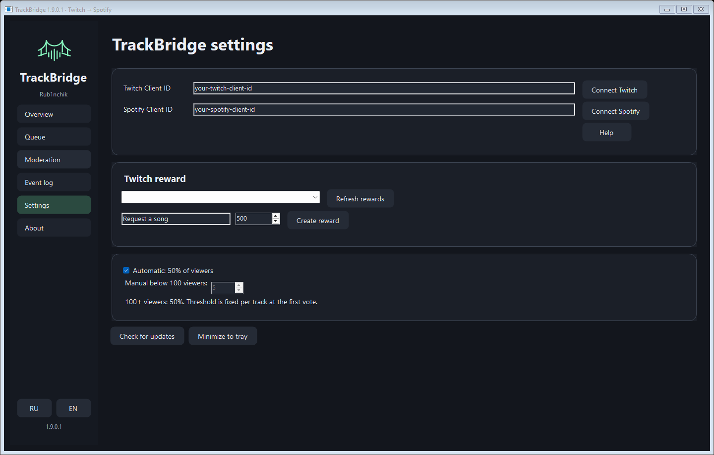
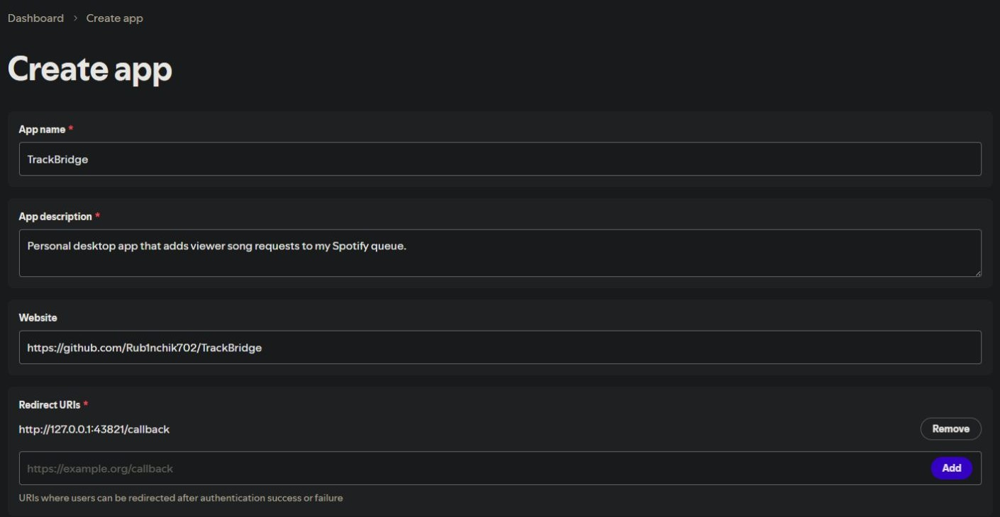
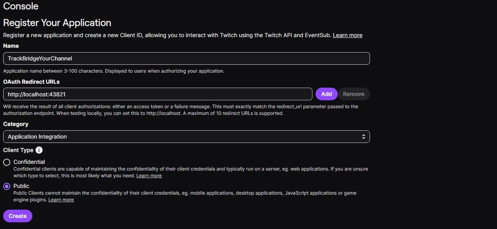
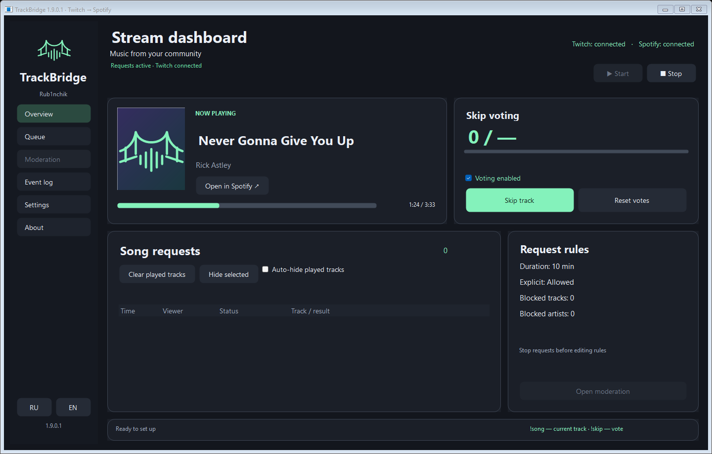

# TrackBridge

[Русский](GUIDE.ru.md) · **English** · [Home](../README.md)

**By Rub1nchik · Windows · 1.10.0**

TrackBridge connects a custom Twitch Channel Points reward to your Spotify queue. Viewers submit a song link, the app finds a matching Spotify track and adds it to the end of your queue without interrupting the current song.

## Music rights and broadcasting

TrackBridge only controls the queue and playback in your own Spotify player; it does not transmit an audio stream to viewers. It does not grant rights to music or permission to use it in broadcasts, live streams or recordings. Users are responsible for obtaining the necessary rights and permissions and complying with rights holders’ rights, applicable law and the terms of Spotify, Twitch and other services they use. Spotify Premium, catalog availability and successful queueing do not authorize broadcasting.

## Screenshots

TrackBridge **1.10.0**, shown with demonstration data.

### Overview

### Queue and history cleanup

### About and DonateX

## Custom notification sound

In Settings, choose **Choose WAV…** to replace the built-in chime, or **Default sound** to restore it. Supported files: 16-bit PCM WAV, mono or stereo, up to 5 seconds and 2 MB. TrackBridge stores a copy in its data folder, so moving the original file does not break the selected sound. The sound choice survives restart and normal application updates. The volume control applies to both sounds. If the custom file becomes unavailable or damaged, the built-in signal is used.

## Sound notifications

A short, quiet two-note chime plays after Spotify confirms a viewer's track was added to the queue. In Settings, turn the sound on or off, adjust its level (0–40%; default 20%), or use Preview sound. It uses the Windows default audio output; overall loudness also depends on your system and speakers. Requests processed while a previous chime is playing do not overlap it. Failed requests, refunds and resumed reward finalization do not play a chime.

## Features

- Direct Spotify track links.
- Spotify matching for YouTube and YouTube Music links. Text in round or square brackets in YouTube titles is ignored.
- Automatic point refunds and Twitch chat notifications when no confident match is found.
- Twitch EventSub with fallback checks for pending redemptions every 10 seconds.
- Duplicate prevention and manual resolution of uncertain playback requests.
- System tray support and Windows DPAPI protection for stored tokens.
- Automatic GitHub release checks, verified downloads and restart-to-install updates.
- Russian and English UI. Use the RU/EN buttons in the sidebar; changes apply immediately and are saved. Account IDs and custom reward titles are preserved. Earlier log entries stay in their original language. New chat notifications use the selected language.

## Download

Get the Windows ZIP from [Releases](https://github.com/Rub1nchik702/TrackBridge/releases). Extract the entire archive to a writable folder and run `TrackBridge.exe`.

Requires Windows 10/11, .NET Framework 4.7.2 or later, Spotify Premium and an active Spotify player. Your Twitch channel must support custom Channel Points rewards. The executable has no Windows code-signing certificate. Public-source builds use no obfuscation.

## Setup

Screenshots below show TrackBridge 1.9.0.2 with demonstration data. Replace the example Client IDs with your own; the images do not show real accounts or authorization tokens.

### 1. Open Settings

Extract the entire Windows ZIP into a writable folder, run `TrackBridge.exe`, choose **EN** if needed, and open **Settings** in the sidebar.

### 2. Register the developer apps and connect your accounts

First open the [Spotify Developer Dashboard](https://developer.spotify.com/dashboard), sign in, and create an app for your own account. Use these values:

| Field | Value |
| --- | --- |
| App name | TrackBridge, or your own descriptive name |
| App description | Personal desktop app that adds viewer song requests to my Spotify queue. |
| Website | Your project URL, if the form requires one |
| Redirect URI | `http://127.0.0.1:43821/callback` |
| API | Web API |

Example Spotify form with the name, description, project website and redirect URI filled in:

Select **Web API**. Read Spotify's terms, accept them yourself, and click **Save**:

Save the app and copy its **Client ID**. In TrackBridge, paste it into **Spotify Client ID**, click **Connect Spotify**, and approve access in the browser. Keep TrackBridge open until the browser returns to its local callback. A Client Secret is not needed. Spotify Premium is required; if the developer dashboard requires an allowed-user entry, add the Spotify account you will connect. See [Spotify app setup](https://developer.spotify.com/documentation/web-api/concepts/apps) and [redirect URI requirements](https://developer.spotify.com/documentation/web-api/concepts/redirect_uri).

Then open the [Twitch Developer Console](https://dev.twitch.tv/console/apps), sign in as the channel owner, and register an application:

| Field | Value |
| --- | --- |
| Name | TrackBridge, or another available app name |
| OAuth Redirect URL | `http://localhost:43821`, if required; click Add and save |
| Category | An appropriate integration category, such as Application Integration if offered |
| Client type | Public |

Example Twitch form: select **Application Integration** and **Public**. Use an available name; replace YourChannel with your own name. Click **Create**, then open the app's management page to copy its Client ID:

Copy its **Client ID** into **Twitch Client ID**, click **Connect Twitch**, and follow the browser instructions to authorize the channel owner's account. Allow the requested chat access so song replies and refund notifications can work. If a device code is shown, enter that current code on Twitch's activation page. See [Twitch app registration](https://dev.twitch.tv/docs/authentication/register-app) and [Device Code Flow](https://dev.twitch.tv/docs/authentication/getting-tokens-oauth/#device-code-grant-flow).

### 3. Create or choose a Channel Points reward

In **Settings → Twitch reward**, enter a reward name and points cost, then click **Create reward**. Alternatively, click **Refresh rewards** and select a reward previously created using the same Twitch Client ID.

If configuring the reward in Twitch, require text input so viewers can paste links, and keep redemptions in the request queue. Rewards created by a different developer app cannot be managed by this Client ID. Your Twitch channel must support custom Channel Points rewards.

### 4. Start Spotify and enable requests

Open Spotify and play a track on the device you want to use. Return to **Overview** in TrackBridge and click **Start**. Wait for **Requests active · Twitch connected** before viewers use the selected reward.

Viewers can submit a Spotify track link, a YouTube link or a YouTube Music link. TrackBridge resolves supported video links to Spotify tracks and appends accepted requests to the Spotify queue. Keep both Spotify and TrackBridge running. Connecting accounts alone does not start request handling. Each broadcaster supplies their own developer application IDs.

## Automatic updates

Starting with version 1.8, TrackBridge checks the public `Rub1nchik702/TrackBridge` GitHub Releases feed at startup and every six hours, including beta releases. It downloads a newer Windows archive into `.updates` next to the app and verifies the SHA-256 digest supplied by GitHub.

When ready, click **Install update** and confirm the restart. Request handling stops cleanly; only packaged application files are replaced. Your `data` folder is preserved. If replacement fails, files already changed are rolled back. You can also click **Check for updates** manually. GitHub outages do not stop song requests.

Version 1.7 needs a one-time manual upgrade to 1.8 or later. Close the old app, replace its files and keep `data`. The updater requires write access to the installation folder.

## Limitations

- Matching may miss a song that exists in Spotify. Direct Spotify links are more reliable.
- Songs are appended to the existing queue. Reward fulfillment confirms that Spotify accepted the queue request, not that the song played to completion.
- If a Spotify response is lost, the request is marked **Check manually** instead of being resent. Inspect the Spotify queue and use the request's context menu to confirm or refund it.
- Starting the app also recovers pending redemptions for the selected reward, including purchases made while the app was closed. Cancel unwanted redemptions in Twitch before starting.
- OBS now-playing output and a clickable Twitch Extension are not included in this release.

## Privacy and support

Client IDs, tokens and request history are stored in `data/settings.bin`, protected using Windows DPAPI for the current Windows account. Do not upload or share `data`. DPAPI does not protect against software running as the same Windows user. To reset, close TrackBridge and rename `data`. Account access can be revoked in Twitch and Spotify settings.

When reporting a problem, include the version, steps and sanitized log lines. Do not share settings files, tokens, authorization codes, Client Secrets or viewers' private information.

## License

By **Rub1nchik**. See [LICENSE.txt](../LICENSE.txt) and [THIRD-PARTY-NOTICES.txt](../THIRD-PARTY-NOTICES.txt). Source is available in [src](../src) for inspection and private personal modifications under [LICENSE.txt](../LICENSE.txt). Selling the software or distributing modified binaries or source requires written permission from Rub1nchik. The TrackBridge name and logo identify official releases; they may not be used to impersonate them. This is source-available, not OSI open source.

TrackBridge controls your own Spotify player and does not grant broadcasting rights. Premium does not authorize streaming music to an audience. Follow [Spotify's policies](https://developer.spotify.com/policy) and Twitch's rules. TrackBridge is not affiliated with Spotify, Twitch, YouTube. The app is free to use. Optional DonateX support is available from About; donating is not required to use the app.

## Queue and updater protections in 1.8.2

The app retains up to 100 active requests, 500 completed history entries and 5000 recent receipt IDs. Each viewer can have up to three active requests. When the global queue is full, additional redemptions remain pending in Twitch until space becomes available. Temporary failures are deferred rather than blocking the queue; after three failed attempts a refund is requested. Failed Twitch finalization requires manual resolution.

Future updates require a publisher-signed RSA/SHA-256 manifest verified against a pinned public key. For a trusted transition, install 1.8.2 manually from a trusted package: 1.8 and 1.8.1 cannot verify publisher signatures. This package signature is separate from Windows Authenticode code signing.

## Chat commands

- `!song` or `!nowplaying` replies with the current Spotify track and link, with a shared 5-second reply cooldown.
- `!skip` or `!voteskip` votes to skip. Automatic mode requires 50% of viewers, rounded up (11 viewers → 6 votes). Below 100 viewers, the owner can choose a manual threshold of 1–99 votes. At 100 or more viewers, 50% always applies.
- Twitch viewer count is fetched at the first vote and the threshold is fixed for that track. No new votes are accepted without a live viewer count. Duplicate Twitch user IDs are ignored. Votes reset on track changes or rewinding to the beginning. Change settings while stopped. Skipping does not refund channel points.
- Click Start and keep Spotify active. Reconnect Twitch once to grant permission to read and send chat messages.

## Controls and moderation

The live panel shows the current track, Twitch viewer count and vote progress. Click the track to open Spotify. Viewer count refreshes about every 30 seconds; the vote threshold remains fixed for the track.

Use Skip track or Reset votes while requests are running. Voting enabled can disable viewer votes while keeping song commands. Resetting votes does not unlock a skip with an uncertain Spotify response.

While stopped, open Request moderation to set a duration limit (10 minutes by default; 0 disables it), block Explicit tracks, and edit blocked track/artist lists. Use one entry per line. Matching is exact and case insensitive. Tracks accept Spotify links or exact titles; title bans apply to all artists. Artist entries use the exact Spotify name. Explicit relies on Spotify metadata and cannot guarantee filtering every unwanted lyric.

Rules apply before queueing pending and new requests, including direct Spotify links. Tracks already queued are not removed. Rejected orders refund points; unavailable metadata is handled as a temporary failure.

## Interface

Use Overview, Queue, Moderation and Settings in the sidebar. Settings contains account connections, the Twitch reward, voting threshold and updates. Start and stop requests from Overview.

The player card shows the track title, artist, Spotify cover when available and playback progress. The voting card displays votes and the fixed threshold. The bridge and waveform logo is also used for the application and tray icons.

## Build from source

On Windows run `powershell -NoProfile -File .\build.ps1` with .NET Framework 4.7.2 or newer and its C# compiler. Output goes to `dist`. GitHub Actions builds the same source on main pushes and manual dispatch, without obfuscation. Artifacts are associated with a commit; byte-for-byte reproducibility is not claimed.

The workflow receives no secrets and does not sign updater packages. Actions artifacts are for manual installation; official automatic updates are additionally signed by the author outside CI. src/SigningKey.cs contains only the public verification key. Never publish data, .updates, tokens, private keys or local history. Available source does not guarantee that any third-party binary is safe.

## Contributors

- **Rub1nchik** — author and owner of TrackBridge.
- **OpenAI Codex** — assistance with development, interface design and documentation.

## About

The About page in the sidebar shows the current version, author Rub1nchik and OpenAI Codex assistance. The DonateX button opens voluntary support at https://donatex.gg/donate/rub1nchik.

## Event log

The event log has its own sidebar page with wrapped lines, optional auto-scroll, copy and clear controls. It is kept in memory for the current session with bounded history. Remove personal information before sharing.

## Request history cleanup

Clear played tracks hides requests that TrackBridge observed playing and subsequently leaving playback (including skips). Check one or more rows, then click Hide selected to hide them from history regardless of status. Highlighted rows are used when no boxes are checked; checkbox choices survive table refreshes. Hiding never cancels requests, refunds points or removes songs from Spotify. Auto-hide is optional and saved. This cleans TrackBridge history, not the Spotify queue. Clear played tracks protects the currently playing track and unplayed or uncertain requests. Playback that happened while the app was stopped is not guessed retroactively.

